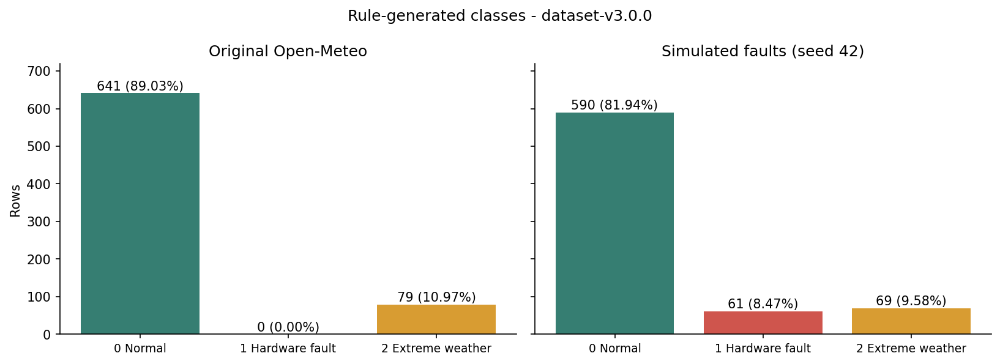
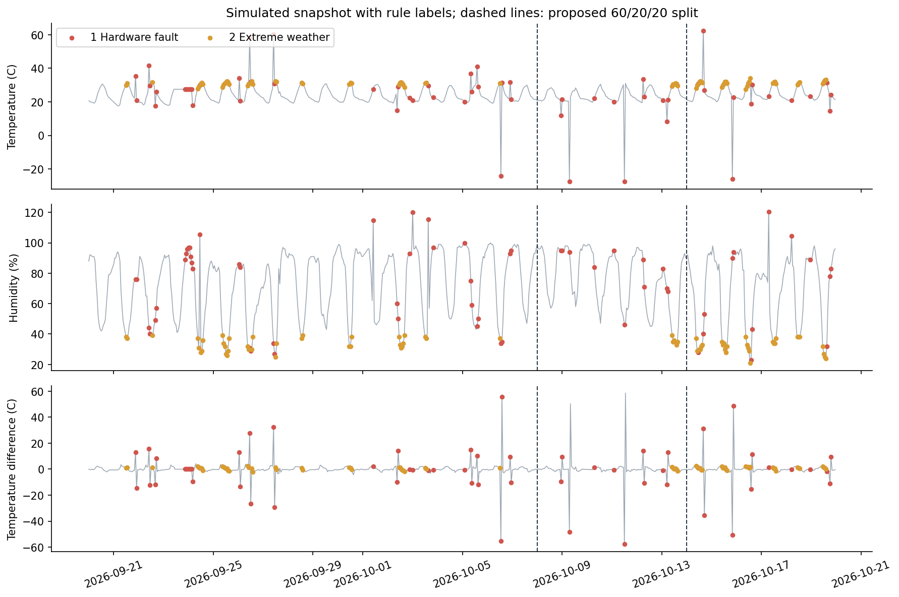
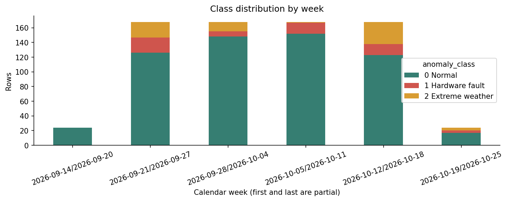
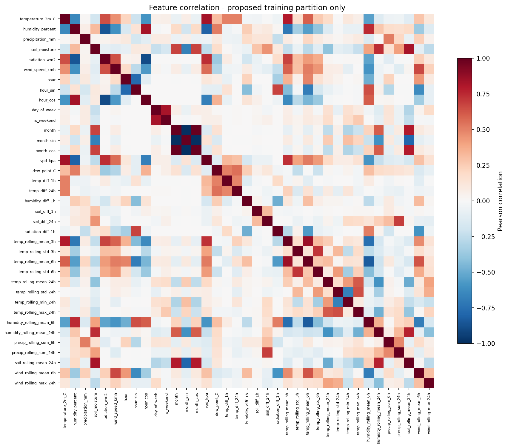
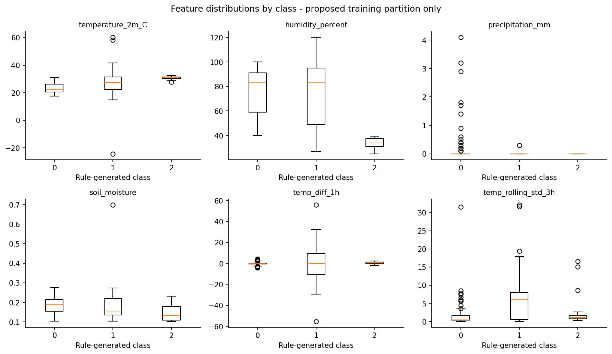

# Audit LK01–LK05 dan EDA Persiapan LK06

> Audit ini merekam keadaan sebelum implementasi. Training dan MLflow kini
> sudah diterapkan; lihat [hasil dan cara menjalankan LK06](README.md).

Tanggal audit: 19 Oktober 2026. Branch: `feat/lk06-mlflow-training`.
Commit awal audit: `5ad7930`, juga ditunjuk tag `dataset-v3.0.0`.

Random Forest sudah dipilih pengguna sebagai algoritma LK06. Audit ini memeriksa
fondasi proyek dan kelayakan rancangan evaluasinya. Belum ada training Random
Forest, eksperimen MLflow, model terbaik, atau screenshot dashboard yang
dihasilkan dalam tahap EDA ini.

## 1. Peta pekerjaan yang sudah dilakukan

| LK | Bukti dalam repositori | Capaian yang dapat diverifikasi | Batas atau pekerjaan lanjutan |
|---|---|---|---|
| LK01 | PDF 11 halaman di `Documentation/LK01/`; notebook PoC 27 sel | Definisi multiclass 0/1/2; domain Smart Farming Malang; sumber Open-Meteo; rancangan ingestion, training, registry, serving, dan monitoring; PoC fetch/EDA/pelabelan aturan | Rancangan end-to-end belum berarti seluruh layanan sudah diimplementasikan. PoC belum melatih model ML. |
| LK02 | `.devcontainer/devcontainer.json`, `requirements.txt`, struktur folder, README, panduan GitHub Flow, gambar bukti, riwayat merge PR | Environment Codespaces Python 3.11 didefinisikan; struktur repo dan alur feature branch/PR tersedia | Checklist dokumen LK02 masih menandai Codespaces dan branching belum selesai, walaupun berkas dan riwayatnya sudah ada. Runtime Codespaces tidak dijalankan ulang pada audit ini. |
| LK03 | PDF 20 halaman, Markdown arsitektur, diagram | Kontrak tujuh kolom raw; taksonomi anomali; rancangan fitur dan alur DVC/MLflow/FastAPI/monitoring | Baseline musiman adaptif masih rancangan. Labeler saat ini memakai ambang tetap. `configs/pipeline_config.yaml`, retraining DAG, serving, dan monitoring yang digambarkan belum tersedia sebagai implementasi. |
| LK04 | Modul ingestion/preprocessing, CLI, DAG, tes, laporan PDF/DOCX/Markdown dan versi `[FIX]` | Retry, deduplikasi, rolling buffer, atomic CSV write; cleaning → rule labeling → feature engineering; keluaran 40 kolom | DAG saat ini hanya ingestion → upload R2; preprocessing tersedia melalui CLI tetapi belum menjadi task DAG. Scheduler VPS aktif tidak diperiksa langsung. Laporan lama menyebut 67 tes; audit sekarang menjalankan 85. |
| LK05 | `.dvc/`, pointer raw, tag v1/v2, laporan PDF 8 halaman, bukti diff/checkout | Versioning data, perbandingan v1 720 baris dan v2 936 baris, pemulihan snapshot didokumentasikan; Git menyimpan pointer, CSV di cache/remote | Implementasi saat ini melacak raw dan simulated dengan pointer per file. Processed adalah turunan yang harus dibangun ulang, bukan dataset DVC terpisah. |

Perkembangan sesudah LK05:

- `src/r2_sync.py` menambah upload snapshot bertimestamp dan `raw/latest.csv`,
  download, serta listing Cloudflare R2. R2 memakai API kompatibel S3; istilah
  penyimpanan yang tepat di repo adalah **R2**, bukan S2.
- Default remote DVC beralih ke R2, sedangkan remote SSH VPS tetap tersedia.
- `src/simulate_data.py` menyediakan injeksi fault dan simulasi pergeseran
  distribusi. Seed 42 dapat direproduksi.
- Commit `de5a8d4` menambah simulator; `5ad7930` membekukan raw dan simulated v3.
  Keduanya berada di atas `origin/main` yang tersimpan lokal pada `6a25e0e`.
  Audit ini tidak memutakhirkan ref Git dari GitHub.
- Ada penghapusan `src/hello.py` yang sudah ada sebelum audit. Tidak diubah oleh
  pekerjaan ini. Tidak ada commit, push, checkout, ingestion API, atau perubahan
  dataset sumber yang dilakukan dalam audit.

## 2. Verifikasi lingkungan dan data

Perintah yang dijalankan:

```text
python -m unittest discover tests
Ran 85 tests ... OK

python -m dvc status
Data and pipelines are up to date.

python -m dvc status --cloud -r r2
Cache and remote 'r2' are in sync.
```

Status remote adalah pemeriksaan baca saja; tidak menjalankan `dvc push` atau
`pull`. Hash isi kedua CSV juga dihitung langsung dan cocok dengan pointer
pada tag v3.

| Sumber | Jumlah baris | Rentang timestamp lokal WIB | MD5 |
|---|---:|---|---|
| `data/raw/weather_raw_current.csv` | 720 | 20 September 00:00–19 Oktober 2026 23:00 | `9684e1329ae170b08883d1ea643eb174` |
| `data/simulated/weather_faults_s42.csv` | 720 | Sama | `64d906e7d0086d1814f5e61b359e22fe` |

Keduanya memiliki tujuh kolom raw, timestamp terurut, tanpa timestamp duplikat,
tanpa nilai hilang, dan 719 langkah waktu yang seluruhnya tepat satu jam.
Preprocessing di memori menghasilkan 720 × 40 kolom dengan 37 kandidat input
numerik; tidak ada NaN atau infinity pada kandidat input snapshot ini.

Lingkungan lokal menggunakan Python 3.12.3, pandas 2.2.0, NumPy 1.26.0,
scikit-learn 1.5.0, matplotlib 3.9.0, dan DVC 3.67.1. MLflow belum terpasang
dan belum tercantum di `requirements.txt`. `dvc-s3` 3.3.0 terpasang lokal,
tetapi requirements hanya mendeklarasikan `dvc[ssh]`: clone baru belum
mendeklarasikan dependency transport S3/R2 secara lengkap. Codespaces memakai
Python 3.11; reproduksi lintas environment belum diuji.

### Cache processed tidak boleh dipakai langsung

Ketiga berkas berikut masih berisi snapshot **14 September–13 Oktober 2026**:

| Berkas | Normal | Hardware fault | Cuaca ekstrem | Cocok dengan sumber v3 yang diharapkan? |
|---|---:|---:|---:|---|
| `weather_features_v1.0.csv` | 610 | 58 | 52 | Tidak |
| `weather_features_faults_s42.csv` | 610 | 58 | 52 | Tidak |
| `weather_processed_current.csv` | 610 | 58 | 52 | Tidak |

Nama `weather_features_v1.0.csv` tidak menjamin isinya berasal dari data asli:
file tersebut juga memiliki kelas hardware fault. Asal proses penulisan cache
lama tidak dapat dipastikan hanya dari isi file. Untuk LK06, bangun fitur ulang
dari sumber DVC di dalam alur training dan log hash inputnya. EDA ini tidak
menimpa cache lama.

## 3. Temuan EDA

Analisis yang dapat dijalankan ulang ada di
[`notebooks/LK06_EDA.ipynb`](../../notebooks/LK06_EDA.ipynb).
Output statistik, provenance, dan grafik berada di [`eda/`](eda/).

### Distribusi kelas

| Kelas | Data asli | Simulated faults seed 42 |
|---|---:|---:|
| 0 — Normal | 641 (89,03%) | 590 (81,94%) |
| 1 — Hardware fault | 0 (0%) | 61 (8,47%) |
| 2 — Cuaca ekstrem | 79 (10,97%) | 69 (9,58%) |



Data asli tidak dapat sendirian menyediakan contoh kelas 1. Dataset simulasi
memenuhi kebutuhan awal supervised multiclass, dengan batas bahwa fault
bersifat sintetis.

Prediktor konstan yang selalu menjawab normal memperoleh accuracy **81,94%**
pada seluruh snapshot simulasi, tetapi macro F1 hanya **30,03%**. Ini alasan
konkret untuk menghindari pemilihan model berdasarkan accuracy saja.

### Label merupakan pseudo-label

`AnomalyLabeler` menghasilkan target dari aturan atas sensor dan riwayatnya;
tidak ada anotasi independen dari teknisi atau kejadian sensor nyata. Model
yang mendapat skor tinggi terhadap target ini menunjukkan kemampuan meniru
taksonomi yang dikodekan, bukan bukti bahwa kerusakan sensor lapangan atau
bahaya agronomis sudah tervalidasi.

Variabel mentah yang menjadi dasar aturan tetap dapat menjadi input model
karena tersedia saat inferensi. Yang harus dikeluarkan dari X adalah target
`anomaly_class`, teks `anomaly_reason`, dan timestamp mentah. Jangan menyebut
seluruh variabel pembentuk aturan sebagai kebocoran label: bedakan input
observasi yang sah dari keluaran labeler yang membocorkan jawabannya.

Jika aturan yang sama dijadikan pembanding terhadap target yang dibuatnya
sendiri, skor sempurna akan bersifat sirkular. Model ML belum menunjukkan nilai
tambah atas aturan hanya karena skor imitasi tinggi. Untuk LK06, tujuan yang
jujur adalah mempelajari manajemen eksperimen pada klasifikasi pseudo-label.

### Cakupan anomali masih sempit

- Dari 69 kelas ekstrem pada simulasi, **68 severe dry air dan satu heatwave**.
  Belum ada dukungan data untuk menyatakan semua kategori ekstrem dalam
  dokumen sudah berhasil dikenali model.
- Simulator membuat 36 fault titik ditambah satu blok stuck 18 jam. Sebanyak
  53 baris sensor benar-benar berubah, sementara labeler menghasilkan 61 fault.
  Sebanyak 18 baris tanpa perubahan sensor tetap dilabeli fault karena efek
  temporal, terutama perubahan setelah lonjakan. Ini perlu dijelaskan bila
  membandingkan jumlah injeksi dengan distribusi label.
- Tujuh label temperature stuck semuanya berada di train usulan. Tidak ada
  label stuck di validation/test. Beberapa jenis fault hanya muncul satu kali.
- Data mencakup satu lokasi, 30 hari, dan satu seed fault. Itu belum mewakili
  pergantian musim, keragaman perangkat, atau semua pola kerusakan.
- Ingestion memakai endpoint forecast dengan `forecast_days=1`. Ujung snapshot
  memuat timestamp sampai 19 Oktober 23:00 dan dapat mencakup prakiraan.
  Tidak tersedia metadata waktu penerbitan setiap prediksi untuk merekonstruksi
  seluruh informasi yang tersedia pada waktu observasi historis.





### Fitur dan preprocessing

40 kolom adalah ukuran keluaran pipeline, bukan 40 fitur model. Setelah
mengeluarkan tiga kolom di atas tersisa 37 kandidat input: enam sensor mentah,
fitur kalender/siklis, VPD/dew point, selisih temporal, dan statistik rolling.

Korelasi fitur dan boxplot per kelas dihitung pada 432 baris train usulan.
Fitur `month`, `month_sin`, dan `month_cos` sangat berkorelasi karena hanya dua
bulan terwakili. Itu menunjukkan redundansi pada snapshot pendek, bukan bukti
bahwa pola musiman sudah dipelajari.





Jangan menghapus outlier fisik atau melakukan clipping global sebelum belajar:
nilai di luar rentang justru menjadi sinyal kelas hardware fault. Tidak ada
kebutuhan imputasi pada snapshot ini. Jika kelak diperlukan, statistik
imputasi harus dipelajari hanya dari bagian training.

## 4. Rancangan training yang didukung temuan

### Algoritma

Gunakan Random Forest sebagai kandidat awal sesuai keputusan pengguna. Data
tabular numerik dan keputusan berdasarkan ambang serta interaksi antarsensor
sesuai dengan pendekatan pohon. Scaling tidak menjadi prasyarat untuk split
pohon. `class_weight` perlu dibandingkan, bukan langsung dianggap meningkatkan
performa. Lihat [dokumentasi RandomForestClassifier versi 1.5](https://scikit-learn.org/1.5/modules/generated/sklearn.ensemble.RandomForestClassifier.html).

EDA **tidak dapat membuktikan Random Forest adalah algoritma paling tepat atau
paling unggul**. Klaim itu membutuhkan perbandingan model pada protokol
evaluasi yang sama. Logistic Regression dapat menjadi baseline pembanding
kelak; metode outlier seperti Isolation Forest tidak langsung menyelesaikan
target klasifikasi tiga kelas yang sudah ditetapkan. Untuk LK06, tuning satu
algoritma sudah sesuai instruksi tugas dan menghindari perluasan lingkup.

### Split yang diusulkan: kronologis 60/20/20

| Partisi | Rentang WIB | Baris | Normal | Fault | Ekstrem |
|---|---|---:|---:|---:|---:|
| Train | 20 September–7 Oktober 2026 | 432 | 360 | 37 | 35 |
| Validation | 8–13 Oktober 2026 | 144 | 127 | 11 | 6 |
| Test | 14–19 Oktober 2026 | 144 | 103 | 13 | 28 |

Pakai validation untuk memilih hyperparameter. Setelah pilihan dibekukan,
refit konfigurasi terpilih pada train+validation dan evaluasi test sekali.
Jangan memakai hasil test setiap run untuk memilih juara. Skema temporal
menilai generalisasi ke observasi berikutnya; lihat
[panduan evaluasi time-series scikit-learn](https://scikit-learn.org/stable/modules/cross_validation.html#time-series-split).

Trade-off: validation hanya memiliki enam contoh cuaca ekstrem. Satu kesalahan
mengubah recall kelas itu sebesar 16,67 poin persentase. Alternatif lebih kuat
adalah walk-forward validation pada bagian pengembangan dengan blok test
terakhir tetap disisihkan, dengan biaya fitting dan pelaporan lebih banyak.

Tidak ada shuffle. Tidak ada kebutuhan gap otomatis hanya karena fitur memakai
rolling 24 jam: tugas ini mengklasifikasikan observasi saat ini dan konteks
masa lalu tersedia saat inferensi. Pemeriksaan prefix pada batas baris 432 dan
576 menunjukkan fitur serta label masa lalu identik ketika suffix ditambahkan;
tidak ditemukan ketergantungan pada nilai masa depan pada kedua batas itu.
Ini bukan bukti partisi independen atau historical backtest sempurna.

Distribusi kelas dan alasan label seluruh snapshot, termasuk blok test usulan,
sudah dilihat selama EDA untuk mengaudit cakupan. Laporkan itu secara jujur;
jangan menyebutnya blind test sepenuhnya. Tidak ada fitting atau pemilihan model
berdasarkan skor test dalam EDA ini. Snapshot baru yang belum diinspeksi akan
menjadi evaluasi eksternal lebih kuat.

### Minimal tiga run Random Forest

Usulan variasi terkontrol:

| Run | n_estimators | max_depth | min_samples_leaf | class_weight |
|---|---:|---|---:|---|
| R1 baseline | 100 | None | 1 | None |
| R2 bobot kelas | 100 | None | 1 | balanced |
| R3 batas kedalaman | 100 | 10 | 1 | balanced |

R1→R2 mengisolasi dampak class weight, R2→R3 dampak depth. Semua memakai
`random_state=42`, snapshot, fitur, dan split yang identik. Tiga run berbeda
tidak menjamin tiga skor berbeda; hasil yang sama tetap harus dilaporkan.

Ranking utama: `val_f1_macro`, dengan daftar label tetap `[0,1,2]` dan
penanganan zero division eksplisit. Macro F1 merata-ratakan F1 tiap kelas
tanpa membobotnya dengan jumlah contoh; lihat [definisi resmi F1](https://scikit-learn.org/stable/modules/generated/sklearn.metrics.f1_score.html).
Tambahkan accuracy, balanced accuracy, precision/recall/F1/support per kelas,
confusion matrix, serta gap train–validation untuk mendeteksi overfitting.

SMOTE tidak menjadi default. Interpolasi angka sensor/fitur temporal dapat
menghasilkan hubungan fisik yang tidak konsisten. Class weighting lebih
sederhana untuk eksperimen awal; efektivitasnya tetap harus diukur.

## 5. Kesenjangan terhadap luaran LK06

| Ketentuan | Status setelah audit/EDA |
|---|---|
| Dataset LK05 yang dibekukan | Ada: raw dan simulated di tag v3; pointer/hash/remote sinkron |
| EDA sebelum training | Ada: notebook tereksekusi, statistik, grafik, dan audit ini |
| `train.py` terintegrasi MLflow | Belum ada |
| Dependency MLflow di Codespaces | Belum dideklarasikan atau dipasang |
| Logging parameter, metrik, model | Belum ada run/model yang dilog |
| Minimal tiga run berbeda | Belum dieksekusi |
| Perbandingan dashboard MLflow | Belum tersedia |
| Pemilihan dan pendaftaran registry | Belum tersedia |
| PDF dengan screenshot MLflow | Belum dibuat; grafik EDA bukan screenshot dashboard |
| Metadata parameter terbaik | Belum dapat ditentukan sebelum eksperimen |

Urutan pekerjaan berikutnya:

1. Tetapkan protokol split dan metrik, lalu bangun `train.py` dari input DVC
   dengan preprocessing ulang dan pemeriksaan provenance.
2. Deklarasikan MLflow serta dependency DVC S3/R2 pada environment; pakai
   backend tracking/registry lokal yang dapat dijalankan ulang, misalnya
   SQLite. Lihat [backend MLflow](https://mlflow.org/docs/latest/ml/tracking/backend-stores/).
3. Jalankan tiga konfigurasi RF pada split yang sama. Log parameter, validation
   metrics, signature/input example, model, daftar fitur, hash dataset, commit
   kode, serta confusion matrix dan classification report.
4. Pilih parameter menggunakan validation, jalankan model final sesuai fit
   scope yang terdokumentasi, dan evaluasi test sekali. Daftarkan model yang
   dipilih beserta versi, run ID, sumber pseudo-label, dan batas klaimnya.
5. Buka MLflow UI, ambil screenshot run list dan perbandingan metrik asli,
   kemudian susun PDF LK06 dan metadata deployment. Model registry harus
   menjelaskan apakah inputnya fitur hasil preprocessing atau data mentah
   dengan pipeline yang ikut dipaketkan.

## 6. Menjalankan ulang EDA

Buka notebook pada environment proyek lalu **Run All** dari root repo atau
folder `notebooks/`. Notebook memverifikasi hash v3, melakukan replay simulator
di memori, memeriksa kausalitas pada batas split, menampilkan grafik, dan
menulis ulang artefak di `Documentation/LK06/eda/`.

Ringkasan yang dapat dibaca program tersedia di
[`eda/summary.json`](eda/summary.json). Notebook sengaja berhenti jika input
berbeda dari hash snapshot audit, agar temuan v3 tidak diam-diam diberi sumber
dataset versi lain. Dataset sumber dan processed lama tidak ditimpa.
