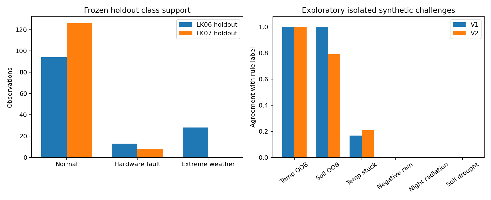

# Audit model sebelum otomatisasi LK08

Tanggal: 4 November 2026. Commit sumber: `bef00d4`.

Dokumen ini merekam kondisi sebelum perbaikan. Status implementasi dan pengujian
terbaru tersedia pada [laporan perbaikan](Perbaikan-dan-pengujian.md).

## Kesimpulan

Model yang berstatus Production pada registry lokal adalah V1 dari LK06,
bukan V2 dari LK07. Artefak model dan prediksi tersimpan dapat direproduksi.
Masalah utama berada pada cakupan data sintetis, definisi target, dan kecukupan
evaluasi. Belum ada bukti bahwa skor turun akibat deployment atau model terlalu
sering memberikan false alarm.

Model dapat meniru sebagian aturan dengan baik, terutama OOB suhu dan spike.
Namun, beberapa aturan sederhana seperti presipitasi negatif tidak konsisten
diikuti. Skor agregat tidak cukup untuk membuktikan kesiapan seluruh keluarga
anomali. Quality gate LK08 perlu menilai kecukupan evaluasi dan performa per
kelas/jenis kejadian sebelum memutuskan registrasi Staging.

## Ruang lingkup dan reproduksi

Audit mencakup ingestion, DVC, simulasi fault, labeler, fitur, temporal split,
CV, pemilihan kandidat, prediksi artefak asli, inferensi berbasis histori,
registry, serta dokumentasi. Audit tidak mengambil data API baru atau mengakses
server deployment. Registry dibaca melalui SQLite mode read-only. Model dimuat
dari artefak skops lokal dengan daftar trusted type yang sama dengan ekspornya.

Perintah reproduksi:

```powershell
.venv/Scripts/python.exe scripts/audit_current_models.py
```

Hasil pengujian langsung:

- Hash raw dan simulated cocok dengan pointer DVC workspace dan Git tag v3/v4.
- Replay simulator seed 42 sama secara numerik dengan kedua snapshot simulated.
- Prediksi V1 pada test LK06 dan V2 pada test LK07 identik dengan CSV tersimpan.
- Fitting diagnosis dengan konfigurasi asal mereproduksi prediksi kedua model
  pada holdout bersama. Keempat forest diagnosis hanya hidup di memori.
- Fitur inferensi 49 jam dibandingkan pada seluruh 269 observasi test kedua
  snapshot. Selisih absolut maksimum sekitar `5,64e-12`; batas audit `1e-8`.
- Prefix checks pada tiga batas setiap snapshot tidak menemukan perubahan fitur
  atau label masa lalu ketika observasi masa depan ditambahkan.
- Normalisasi timezone menghasilkan fitur yang sama untuk WIB dan UTC ekuivalen.
- Gap, urutan terbalik, NaN, infinity, dan singularitas dew point ditolak secara
  eksplisit. Ini pengujian kontrak input, bukan uji fault detection lapangan.
- Hash CSV, kode sumber utama, SQLite, dan artefak model yang diperiksa sama
  sebelum dan sesudah audit.

Baseline pada scan sebelumnya di HEAD yang sama: 99 unit/integration test
lulus; `pip check` bersih. Audit ini menambahkan pemeriksaan perilaku model di
luar cakupan baseline tersebut. Tidak ada model baru yang disimpan, model
registry baru yang dibuat, atau stage yang diubah.

Bukti terstruktur tersedia pada [audit_results.json](audit/audit_results.json),
[errors.csv](audit/errors.csv), [injections.csv](audit/injections.csv), dan
[exploratory_challenges.csv](audit/exploratory_challenges.csv).



Grafik kiri menampilkan jumlah observasi setiap kelas pada holdout yang dibekukan.
Grafik kanan menampilkan kesesuaian prediksi terhadap label aturan pada challenge
terpisah: 24 konteks untuk setiap jenis kecuali radiasi malam, yang memiliki
8 konteks. Challenge merupakan diagnosis eksploratif dengan nilai injeksi tetap;
hasilnya tidak menggantikan test temporal atau mengukur akurasi lapangan.

## 1. Identitas model dan alur yang benar-benar tersedia

| Komponen | Kondisi aktual |
|---|---|
| Sumber cuaca | Endpoint forecast Open-Meteo, lokasi Malang, interval hourly |
| Data V1 | Raw/simulated tag `dataset-v3.0.0`, 720 raw rows, 20 September sampai 19 Oktober |
| Data V2 | Raw history/simulated tag `dataset-v4.0.0`, 714 raw rows, 3 Oktober sampai 1 November pukul 17 WIB |
| Label | Aturan deterministik; hardware fault mendahului extreme weather |
| Fitur | 37 numeric features; target, alasan label, dan timestamp dikeluarkan |
| Warm-up | 48 baris pertama sebagai konteks; tidak digunakan untuk fitting/scoring |
| Pemilihan kandidat | Tiga RF, tiga expanding temporal folds pada 80% development |
| Test | 20% waktu terakhir; diprediksi setelah konfigurasi dibekukan |
| V1 | RF 100 pohon, tanpa class weighting, Production |
| V2 | RF 150 pohon, tanpa class weighting, stage None |
| V3 registry | Duplikat artefak V2; source dan run ID sama, stage None |
| Serving | Ada helper inferensi, belum ada implementasi layanan API di repo |
| Airflow | Ingestion dan upload R2; belum menjalankan training dan evaluasi |

Stage Production adalah metadata registry. Stage tersebut tidak membuktikan
bahwa model sudah melayani request produksi. Karena itu, penjelasan penurunan
skor akibat deployment belum dapat diuji dalam kondisi proyek saat ini.

## 2. Temuan prioritas tinggi

### F01. Target evaluasi berasal dari aturan yang juga tersedia pada input

`AnomalyLabeler` membentuk target dari suhu, kelembaban, presipitasi, radiasi,
angin, dan histori. RF mempelajari fitur dari sumber yang sama. Skor menunjukkan
kesesuaian dengan aturan, belum ketepatan identifikasi kerusakan sensor fisik.
Ini bukan kebocoran kolom target: `anomaly_class` dan `anomaly_reason` memang
dikeluarkan. Keterbatasannya adalah ground truth yang tidak independen.

Untuk tujuan akademik, pendekatan ini dapat dipertanggungjawabkan sebagai
klasifikasi pseudo-label. Untuk kendali aktuator, label fault versus cuaca ekstrem
memerlukan pembuktian tambahan. Contohnya, angka suhu pada data model cuaca tidak
membuktikan sebuah sensor fisik rusak. Klaim pada docstring simulator bahwa data
Open-Meteo selalu bersih juga terlalu mutlak. Sumbernya merupakan keluaran model
cuaca, bukan sensor yang dapat digunakan untuk memverifikasi kerusakan instrumen.

Keputusan yang diperlukan: apakah model ditujukan sebagai demonstrasi peniruan
aturan, quality checking data API, atau diagnosis sensor IoT dengan ground truth
lapangan. Ketiganya memiliki kebutuhan data dan batas klaim yang berbeda.

Sumber: `src/1_data_preprocessing.py:220`, `src/4_training_data.py:53`,
[dokumentasi sumber data Open-Meteo](https://open-meteo.com/en/docs?past_days=1).

### F02. Holdout terbaru tidak memadai untuk gate tiga kelas

| Evaluasi | Normal | Hardware fault | Extreme weather | Macro F1 |
|---|---:|---:|---:|---:|
| V1 pada test LK06 | 94 | 13 | 28 | 0,903905 |
| V1 pada holdout LK07 | 126 | 8 | 0 | 0,622354 |
| V2 pada holdout LK07 | 126 | 8 | 0 | 0,566179 |

Kode menghitung macro F1 dengan label tetap `[0,1,2]` dan `zero_division=0`.
Dengan kelas 2 tidak ada pada target, F1 kelas tersebut bernilai nol dalam
agregasi. Dua kelas lain yang sempurna pun hanya menghasilkan `2/3`.
Gate macro F1 > 0,85 tidak mungkin lolos pada komposisi holdout ini.

Angka nol itu tidak membuktikan model gagal mendeteksi suatu extreme weather
yang benar-benar terjadi. Pada holdout tersebut, kemampuan itu tidak terukur.
Report per kelas sudah menyimpan recall yang tidak terdefinisi sebagai null;
yang belum ada adalah keputusan gate mengenai kecukupan support.

Kelas extreme terakhir pada data v4 berakhir 21 Oktober pukul 13 WIB. Validation
fold ketiga, mulai 21 Oktober pukul 15 WIB, juga tidak memiliki kelas tersebut.
Jadi keterbatasan support turut memengaruhi mean CV V2, bukan hanya final test.

LK01 bagian 5.1 menetapkan F1 > 85%, sedangkan 0,80 adalah ambang pemicu
retraining pada bagian 4.2. Averaging F1 belum ditentukan eksplisit di LK01.
Definisi averaging dan data yang dinilai perlu dibekukan sebelum implementasi
gate. Memilih averaging hanya karena menghasilkan skor lolos akan mengubah
makna evaluasi setelah hasil diketahui.

Sumber: `src/5_model_evaluation.py:38`,
[definisi F1 scikit-learn 1.5](https://scikit-learn.org/1.5/modules/generated/sklearn.metrics.f1_score.html).

### F03. Nama kelas lebih luas daripada cakupan contoh

Pada development V1, seluruh 39 extreme weather berasal dari kelembaban udara
di bawah 40%. Pada development V2, 38 dari 39 berasal dari kondisi tersebut dan
satu dari heat stress. Ini tidak cukup untuk membuktikan pengenalan hujan
ekstrem, angin kencang, kekeringan tanah, waterlogging, atau dingin ekstrem.

Hardware fault juga memiliki cakupan tidak merata:

| Jenis label pada development | V1 | V2 |
|---|---:|---:|
| Temperature spike | 24 | 23 |
| Temperature stuck | 7 | 7 |
| Temperature OOB | 5 | 7 |
| Humidity OOB | 4 | 4 |
| Soil moisture OOB | 2 | 3 |
| Negative precipitation | 1 | 1 |
| Negative radiation | 1 | 1 |
| Negative wind | 1 | 2 |
| Night radiation | 1 | 0 |

Tujuh observasi suhu stuck berasal dari satu blok 18 jam. Itu bukan tujuh
kejadian kerusakan independen. Tidak ada suhu stuck di kedua final test.
Dengan seed 42, blok stuck jatuh pada awal development untuk kedua snapshot.
Jenis kelembaban stuck 24 jam dan angin stuck 48 jam tidak diinjeksikan oleh
simulator saat ini. Evaluasi agregat tidak menguji seluruh taksonomi labeler.

Sumber: `src/3_simulate_data.py:57`, `src/3_simulate_data.py:79`, hasil replay
pada `audit_results.json` dan `injections.csv`.

### F04. Model melewatkan aturan sederhana dengan confidence tinggi

Diagnosis mengubah satu skenario pada salinan 49 jam konteks raw v4. Dipilih
24 waktu yang menurut rule normal, tersebar sepanjang snapshot; nilai injeksi
tetap dan hasil label diperiksa kembali. Penggunaan konteks dari snapshot yang
sudah dikenal menjadikan ini uji perilaku, bukan independent generalization test.

| Skenario | Prediksi sesuai rule V1 | V2 |
|---|---:|---:|
| Normal tanpa injeksi | 24/24 | 24/24 |
| Suhu 65 C, OOB | 24/24 | 24/24 |
| Spike suhu +10 C dari jam sebelumnya, tanpa hujan | 24/24 | 24/24 |
| Soil moisture 0,7, OOB | 24/24 | 19/24 |
| Humidity 115%, OOB | 18/24 | 11/24 |
| Suhu stuck selama 18 jam | 4/24 | 5/24 |
| Humidity 100% selama 24 jam | 9/24 | 1/24 |
| Angin nol selama 48 jam | 0/24 | 0/24 |
| Presipitasi -5 mm | 0/24 | 0/24 |
| Radiasi 250 W/m2 pada malam hari | 0/8 | 0/8 |
| Soil moisture 0,05, drought | 0/24 | 0/24 |

V1 menganggap semua presipitasi negatif pada challenge sebagai normal; pada
sebagian kasus confidence prediksi mencapai 1,0. Drought juga seluruhnya
dianggap normal, dengan confidence salah sampai 0,99. Ini tidak menunjukkan
calibration model yang baik; belum ada calibration test yang membenarkan
interpretasi confidence sebagai peluang kebenaran fisik.

Gejala yang sama ada pada test asli V1: soil OOB 0,800 diprediksi extreme weather
dengan confidence 0,91; angin -7,9 km/h diprediksi normal dengan confidence 0,87.
RF belum menjamin kepatuhan terhadap batas fisik sederhana, meskipun indikator
raw tersedia. Keberadaan satu contoh fault di train tidak menjamin aturan
tersebut berhasil dipelajari.

## 3. Simulasi dan label yang membingungkan

### F05. Proporsi injeksi berbeda dari proporsi fitur dan label yang terpengaruh

| Ukuran | V3 data | V4 data |
|---|---:|---:|
| Raw rows | 720 | 714 |
| Raw rows yang sensor saat ini berubah | 53 | 53 |
| Persentase raw berubah | 7,36% | 7,42% |
| Eligible rows setelah warm-up | 672 | 666 |
| Rows dengan setidaknya satu fitur berubah | 522 | 518 |
| Persentase eligible dengan fitur berubah | 77,68% | 77,78% |
| Rows berlabel normal tetapi fiturnya berubah | 412 | 430 |
| Rows berlabel fault tanpa perubahan raw saat ini | 17 | 14 |

`fault_rate=0.05` mengatur jumlah point injection; blok stuck ditambahkan di
luarnya. Jumlah perubahan raw juga tidak sama dengan jumlah label fault.
Contohnya, satu lonjakan suhu dapat memicu label spike ketika suhu kembali
normal, karena perbedaan dari jam sebelumnya masih besar. Rolling statistics
dan selisih 24 jam memperluas dampak injeksi ke banyak observasi berikutnya.

Ini bukan bukti future leakage. Pipeline menggunakan masa lalu dan pengujian
prefix lulus. Namun, frasa "hanya memanipulasi 5% data" tidak menggambarkan
distribusi fitur yang benar-benar diterima model. Baris normal bisa berarti
sensor saat ini normal sementara histori masih berisi fault.

### F06. Prioritas fault dapat mengubah makna cuaca ekstrem

Saat suhu terakhir dinaikkan menjadi 36 C pada challenge, 16 dari 24 konteks
justru diberi label hardware fault, karena lonjakannya melebihi 8 C tanpa hujan.
Delapan lainnya diberi label heat stress. Kedua model gagal menyamai label
heat stress pada delapan kasus tersebut.

Hasil ini menjelaskan mengapa penilaian tidak boleh memakai nama skenario
injeksi sebagai ground truth tanpa mengecek label aktual. Aturan menggunakan
prioritas hardware fault di atas extreme weather; satu kondisi yang memenuhi
keduanya hanya memperoleh satu label dan satu alasan. Kenaikan suhu cepat yang
nyata dapat dianggap fault oleh aturan, tetapi validitas fisiknya belum diuji.

Indikator `soil_waterlogged_48h` juga dihitung, tetapi kondisi berikutnya
`is_waterlogged or soil > 0.48` membuat durasi 48 jam tidak diperlukan untuk
memberi label waterlogging pada data finite. Jika maksud domain mensyaratkan
kejadian berkelanjutan, aturan sekarang tidak menerapkan syarat itu.

Sumber: `src/1_data_preprocessing.py:287`, `src/1_data_preprocessing.py:331`.

### F07. Fitur belum memuat seluruh indikator labeler

Label suhu stuck memakai standar deviasi 12 jam, tetapi model hanya menerima
std 3/6/24 jam. Indikator humidity stuck 24 jam dan wind zero 48 jam juga tidak
menjadi input model. RF harus mempelajari pendekatannya dari fitur lain, padahal
contoh kejadiannya sangat sedikit atau tidak ada.

Ketidaksesuaian ini konsisten dengan kelemahan pada challenge stuck, tetapi
belum membuktikan penambahan indikator pasti menyelesaikannya. Itu memerlukan
eksperimen development yang terpisah dan evaluasi baru.

## 4. Training dan evaluasi

### Bagian yang berfungsi

`train.py` membangun fitur ulang dari raw simulated yang diverifikasi DVC.
Tidak ada shuffle, scaling yang dilatih pada test, atau kolom label/reason
di dalam input model. Fitur current-hour sah untuk klasifikasi kondisi jam
tersebut; desain ini bukan forecasting kejadian di masa depan.

CV memakai train sebelum validation. Kandidat dipilih dengan mean validation
macro F1, lalu std dan urutan konfigurasi sebagai tie-break. Forest final
di-fit pada development saja. Test baru diprediksi setelah pemilihan kandidat.
Label dan fitur yang diperiksa tidak berubah saat data masa depan ditambahkan.

Model V1 menampilkan train CV F1 1,0 versus mean validation 0,8122; V2 1,0
versus 0,6380. Gap ini mengindikasikan keterbatasan generalisasi dan kemungkinan
overfitting, tetapi tidak mengisolasi penyebab karena distribusi waktu dan
support kelas juga berubah. Class weighting dan batas depth 10 pada kandidat
yang tersedia tidak meningkatkan mean CV; keduanya bukan solusi otomatis.

### F08. Skor tinggi masih menyembunyikan fault yang terlewat

Confusion matrix V1 pada test LK06, baris = label aturan, kolom = prediksi:

| Aktual / prediksi | Normal | Fault | Extreme |
|---|---:|---:|---:|
| Normal | 94 | 0 | 0 |
| Fault | 3 | 8 | 2 |
| Extreme | 0 | 0 | 28 |

Macro F1 0,9039 dapat bersamaan dengan recall fault 8/13 atau 61,54%.
Lima fault salah diklasifikasikan; dua di antaranya menjadi extreme weather.
Untuk sistem dengan respons aktuator berbeda, jenis kesalahan itu tetap
penting meskipun macro F1 lolos 0,85.

Pada holdout LK07, V1 menghasilkan 125 normal benar, satu false alarm pada
126 normal, tujuh fault benar, dan satu fault menjadi normal. V2 menghasilkan
satu false alarm dan tiga fault menjadi normal. False alarm rate observasi
normal pada keduanya adalah 1/126 atau sekitar 0,79% terhadap rule label.
Tidak ada bukti dari holdout ini bahwa terlalu sensitif merupakan masalah
utama. Jumlah kejadian juga terlalu kecil untuk menjamin kestabilan rate itu.

### F09. Efek jumlah pohon dan dataset semula tercampur

Diagnosis empat forest di memori memakai development dan fitur yang sama
dengan protokol asal, seed 42, serta holdout v4 yang sama:

| Dataset development | Pohon | Macro F1 pada holdout v4 | Fault terdeteksi |
|---|---:|---:|---:|
| V3 | 100 | 0,622354 | 7/8 |
| V3 | 150 | 0,596047 | 6/8 |
| V4 | 100 | 0,566179 | 5/8 |
| V4 | 150 | 0,566179 | 5/8 |

Dengan data v4, menambah pohon tidak mengubah confusion matrix. Dengan data
v3, penambahan pohon membuat satu fault tambahan terlewat pada sampel ini.
Penggantian dataset pada 100 pohon juga menurunkan deteksi dari 7/8 menjadi
5/8. Hasil ini mengisolasi perubahan pada seed dan sampel yang diperiksa;
tidak membuktikan bahwa 100 pohon selalu unggul atau data baru selalu buruk.
Tidak ada konfigurasi yang dipilih untuk deployment dari diagnosis ini.

### F10. Snapshot baru dan evaluasi independen perlu dibedakan

Raw v3 dan v4 memiliki 408 timestamp yang sama, dari 3 sampai 19 Oktober.
Sebagian nilai raw pada timestamp sama berubah: 16 suhu, 16 humidity, 13 soil,
10 radiasi, dan 17 angin; presipitasi tidak berubah. Ini konsisten dengan
snapshot rolling yang diperbarui, tetapi audit tidak mengatribusikan seluruh
perubahan tersebut ke satu mekanisme upstream tertentu.

Holdout bersama LK07 dimulai 27 Oktober, setelah akhir fit kedua model;
pemeriksaan ini tidak menemukan kebocoran fitting langsung pada holdout tersebut.
Namun, holdout LK07 sudah dipakai memilih V1 sebagai Production, sehingga tidak
lagi menjadi independent post-selection test. Menguji V2 pada test lama LK06
juga bukan evaluasi independen karena periode itu bertumpang tindih dengan
development V2. Skor tersebut hanya diagnostik dan tidak dipakai dalam keputusan.

Sumber API forecast dan revisi rolling juga belum merekonstruksi apa yang
tersedia pada setiap saat historis. Ini batas provenance/backtesting, bukan
bukti bahwa kode memakai future rows pada perhitungan rolling.

## 5. Kontrak inferensi dan artefak

### F11. Missing fault berada di labeler, tetapi di luar kontrak model

`AnomalyLabeler` dapat memberi kelas 1 pada NaN. Namun, `normalize_raw` menolak
NaN/inf sebelum labeler dipanggil. Jadi model belum mendukung deteksi missing
melalui prediksi kelas 1. Perlakuan saat ini sengaja fail-fast dan lebih jujur
daripada mengisi nol tanpa aturan, tetapi penanganan sistem untuk kasus ini
belum ada. Missing memerlukan jalur kualitas data/alert atau desain model
yang secara eksplisit mendukungnya.

Input suhu -237,3 C juga menunjukkan bahwa nilai raw finite bisa menghasilkan
dew point nonfinite. Pemeriksaan fitur menolaknya. Sistem yang menerima input
ini perlu mengubah penolakan menjadi respons operasional yang jelas.

Sumber: `src/1_data_preprocessing.py:239`, `src/4_training_data.py:48`.

### F12. Cache processed tidak sesuai dengan sumber training sekarang

Ketiga file lokal berikut berisi 720 observasi dari 14 September sampai
13 Oktober, dengan distribusi kelas sama: 610 normal, 58 fault, 52 extreme:

- `data/processed/weather_features_faults_s42.csv`
- `data/processed/weather_features_v1.0.csv`
- `data/processed/weather_processed_current.csv`

File bernama current dan file yang tampak sebagai hasil raw bersih sama-sama
berisi fault sintetis dan snapshot lama. Provenance cache tidak cukup jelas
untuk menyimpulkan penyebab penimpaannya. Training saat ini tidak membacanya,
sehingga ini bukan penyebab skor model asli. Cache tersebut berisiko menghasilkan
analisis atau serving yang memakai sumber salah jika dipakai kembali.

### F13. Label registry dan lineage belum menjadi quality gate

V1 Production dan V2/V3 None dikonfirmasi pada SQLite aktual. V3 registry adalah
pendaftaran ulang artefak V2, bukan eksperimen atau model ketiga yang berbeda.
`train.py:259` tetap meregistrasikan pemenang CV tanpa pemeriksaan threshold
performa atau kecukupan support. `beats_dummy_cv` hanya dicatat setelah
registrasi; nilainya bukan syarat yang menghalangi kandidat buruk masuk registry.

Registrasi sebagai kandidat bukan otomatis kesalahan, tetapi LK08 meminta
registrasi Staging setelah validasi. Alur itu belum tersedia. Script verifikasi
LK07 juga mengharuskan V1 sebagai satu-satunya Production dan menulis keputusan
`retain_v1`; script tersebut adalah verifier snapshot LK07, bukan evaluator
deployment generik yang aman digunakan apa adanya dalam otomatisasi.

### F14. Reproduksi byte data kuat, reproduksi environment masih lokal

V1 dilatih ketika working tree dirty dan memakai nama modul lama. Nama file
saat ini berbeda. Audit membandingkan AST kode preprocessing, training_data,
dan model_evaluation dari artefak V1 terhadap sumber saat ini: setelah module
docstring diabaikan, ketiganya sama secara sintaksis. Ini menjelaskan mengapa
prediksi V1 masih dapat direproduksi; mismatch nama/hash tidak otomatis berarti
logika model berubah. V2 mencatat source hash yang cocok dengan sumber saat ini.

Tetap ada batas: checkout commit training saja tidak merekonstruksi seluruh
working tree dirty. Salinan sumber yang dilog dan source hashes perlu disimpan.
Model juga memerlukan `mlruns/` dan backend SQLite yang cocok; metadata DVC
tidak mencadangkan artefak model. Path artefak masih absolut Windows.

Environment lokal Python 3.12.3 berbeda dari devcontainer Python 3.11.
Dependency `skops` dipakai langsung untuk ekspor tetapi belum dideklarasikan
langsung pada requirements utama, dan pytest belum terpasang saat scan.
Belum dilakukan pembuktian clean install pada runner Linux.

## 6. Prioritas tindak lanjut

1. **Tetapkan makna target dan klaim.** Catat bahwa ground truth sekarang
   berupa aturan dan fault sintetis. Pisahkan kegagalan format/missing,
   batas fisik deterministik, dan inferensi kondisi lingkungan. Untuk aktuator,
   pertimbangkan deterministic guard pada batas fisik yang wajib dipatuhi,
   bukan menyerahkan seluruh pemeriksaan tersebut pada RF.
2. **Bekukan protokol evaluasi sebelum tuning.** Definisikan averaging F1,
   minimum support/kejadian, metrik fault versus extreme, serta hasil
   insufficient coverage. Pisahkan test temporal dari challenge skenario.
   Jangan menurunkan threshold atau memilih snapshot karena skornya lebih baik.
3. **Perbaiki cakupan data pada development.** Tambahkan kejadian independen
   lintas waktu, seed, tingkat keparahan, dan subtipe. Simpan manifest injeksi
   yang mencatat lokasi, jenis, nilai asli, nilai baru, dan rentang kejadian.
   Laporkan event count, bukan menganggap setiap jam stuck kejadian terpisah.
4. **Baru uji perubahan model/fitur.** Fokus pada kegagalan yang direproduksi:
   missing route, negative values, night radiation, stuck, humidity OOB, dan
   extreme subtypes yang belum dipelajari. Evaluasi dampak pada development;
   gunakan holdout baru setelah perubahan yang dipandu hasil audit ini.
5. **Rapikan kontrak dan lineage.** Tandai atau regenerasi cache lama dengan
   identitas sumber yang jelas, pin runtime/dependency, dan simpan artefak
   portabel. Hindari menyamakan stage registry dengan layanan yang sudah deploy.
6. **Integrasikan LK08 setelah kontraknya jelas.** Jalankan pytest, training,
   coverage/performance gate, lalu registrasi Staging. Uji jalur lolos dan
   jalur gagal; kandidat yang gagal tidak boleh dipromosikan demi run hijau.

Tidak ada threshold, simulasi sumber, fitur produksi, model tersimpan, atau
registry yang diperbaiki dalam audit ini. Hasil audit memberikan dasar untuk
memilih perbaikan berikutnya secara terukur.
